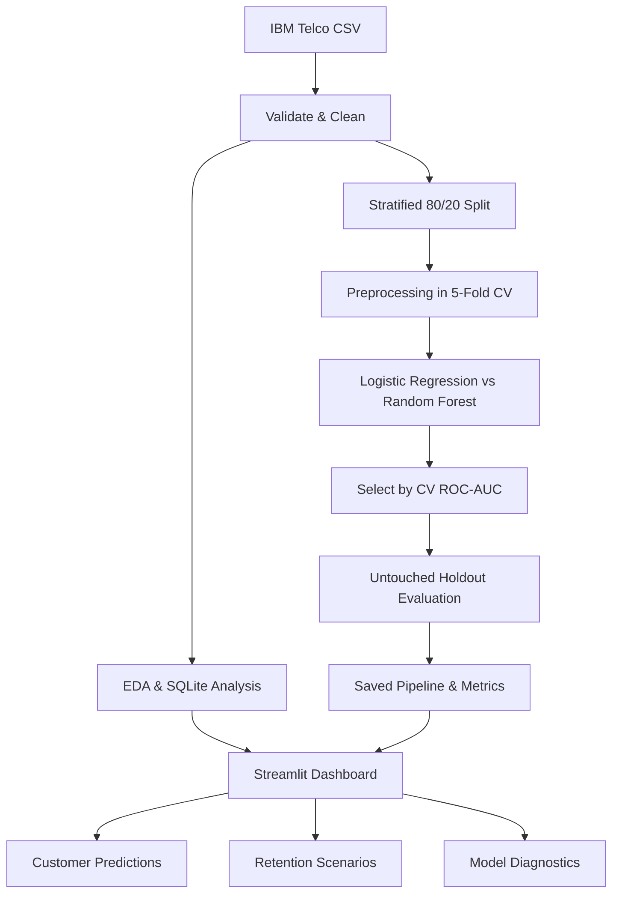

# Customer Churn Prediction & Retention Decision System

**Data science portfolio project | Python · SQL · Scikit-learn · Streamlit**

An end-to-end machine learning demonstration that predicts potential telecom customer churn, explains observed churn patterns, and explores **hypothetical** retention outreach scenarios in an interactive dashboard.

**Live Demo:** [Customer Churn Intelligence Dashboard](https://customer-churn-retention-system-5x.streamlit.app/)

**GitHub Repository:** [View Source Code](https://github.com/jaskaran-pajni/customer-churn-retention-system)

> **Data & ethics:** This project uses the public IBM hypothetical Telco Customer Churn dataset (7,043 records). Predictions are illustrative and are not approved for real customer decisions. The sample data cannot establish whether outreach or discounts cause customers to stay.

## Features

- **Overview:** churn by contract and tenure segment, plus holdout evaluation summary.
- **Single customer:** enter account attributes, estimate churn probability, vary the classification threshold.
- **Batch & retention:** upload CSV or use six fictional examples, rank customers by an assumption-based expected-value calculation, export scored rows.
- **Model diagnostics:** cross-validation results, holdout metrics, ROC/confusion matrix, and model feature signals.

## System Architecture



The project compares models using training-only cross-validation, evaluates the selected model once on an untouched holdout set, and serves the saved pipeline through Streamlit. Retention scenarios use hypothetical assumptions, not measured intervention effects.

## Run locally

Use Python 3.12 when possible and run from the repository root:

```powershell
py -3.12 -m venv .venv
.\.venv\Scripts\Activate.ps1
python -m pip install -r requirements.txt
python -m src.download_data
python -m src.eda
python -m src.build_database
python -m src.train
python -m src.export_dashboard_summary
python -m src.check_dashboard
python -m streamlit run streamlit_app.py
```

If you've already trained Day 2, you can keep your existing `models/` and `outputs/` artifacts; the app does not retrain on each page load. Only load locally trained/trusted model files, because `joblib` uses pickle serialization.

## Measured model evaluation

Model selection: compare Logistic Regression and Random Forest using **stratified five-fold CV ROC-AUC on the training split only**; report precision, recall, F1, average precision, ROC-AUC, and confusion matrix on the untouched test split. The 0.50 holdout threshold is fixed for the reported confusion matrix.

Results from the committed [evaluation metrics](outputs/metrics.json), using a stratified 80/20 train/test split (5,634 training and 1,409 test customers):

| Metric | Measured result |
| --- | ---: |
| Selected model | Logistic Regression |
| Training 5-fold CV ROC-AUC (selected model) | 0.846 |
| Holdout ROC-AUC | 0.842 |
| Holdout average precision | 0.634 |
| Holdout precision (threshold 0.50) | 65.7% |
| Holdout recall (threshold 0.50) | 55.9% |
| Holdout F1 (threshold 0.50) | 0.604 |

Confusion matrix (TN, FP, FN, TP): **926, 109, 165, 209**. [View confusion matrix](outputs/charts/confusion_matrix.png) · [View ROC curve](outputs/charts/roc_curve.png).

These scores describe an IBM hypothetical dataset holdout, not real-world or future-period performance.

## Retention decision simulator (not measured uplift)

The dashboard evaluates a transparent scenario:

`P(churn) × assumed_success × monthly_revenue × assumed_gross_margin × months − offer_cost`

This is an **illustrative prioritization heuristic**, not a causal effect estimate, profit forecast, optimized offer policy, or demonstrated savings. A real deployment would require randomized trials, calibrated probabilities, temporal validation, consent/privacy safeguards, and ongoing monitoring.

## Technologies

- **Pandas, NumPy:** data processing, imputation-aware cleaning, numeric features.
- **SQLite / SQL:** churn and customer-segment queries.
- **Scikit-learn:** Logistic Regression, Random Forest, cross-validation, preprocessing pipeline, saved inference model.
- **Matplotlib:** EDA and model evaluation plots.
- **Streamlit:** interactive analytics, predictions, batch scoring, scenario UI.
- **GitHub Actions / pytest:** unit tests and optional deployment preflight.

## Deployment

Follow **[DEPLOY_DAY3.md](DEPLOY_DAY3.md)** for every step, including generating real model artifacts, pinning Python package versions, safe git staging, and deploying to Streamlit Community Cloud.

Preflight in your local model's training environment:

```powershell
python scripts/prepare_deployment.py
python scripts/prepare_deployment.py --pin-deps
python -m pytest -q tests
```

The four required demo artifacts are `models/churn_pipeline.joblib`, `outputs/feature_schema.json`, `outputs/metrics.json`, and `outputs/segment_summary.csv`. They are generated locally from the IBM public demonstration dataset; no invented model or scores are included in this template.

## Limitations

- IBM's dataset is cross-sectional and hypothetical, not a documented future-outcome production dataset.
- Random holdout performance may not transfer to future periods or other telecom customers.
- Logistic coefficients and forest feature importance describe model associations, not causal drivers.
- Raw probabilities may be miscalibrated; check calibration before communicating literal risk levels.
- Real retention effectiveness cannot be inferred without treatment assignment and follow-up outcomes.
- Do not upload private customer information to a public demonstration service.

## Data source

Public IBM example dataset: https://github.com/IBM/telco-customer-churn-on-icp4d/blob/master/data/Telco-Customer-Churn.csv
